<div align="center">
  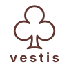
  <h1>Vestis — Gestão inteligente para lojas de locação</h1>
  <p><strong>Plataforma SaaS multi-tenant para gestão de acervos, controle de locações e vitrines digitais para lojas de aluguel de roupas e alta costura.</strong></p>
  <p>
    
    
    
    
    
    
  </p>
</div>

---

## 📌 Sumário

1. [Sobre o Projeto](#-sobre-o-projeto)
2. [O Problema que o Vestis Resolve](#-o-problema-que-o-vestis-resolve)
3. [Como Funciona](#-como-funciona)
4. [Fluxo de Atendimento e Regras de Negócio](#-fluxo-de-atendimento-e-regras-de-negócio)
5. [Arquitetura do Sistema](#-arquitetura-do-sistema)
6. [Telas e Referências Visuais](#-telas-e-referências-visuais)
7. [Tecnologias Utilizadas](#-tecnologias-utilizadas)
8. [Como Executar Localmente](#-como-executar-localmente)
9. [Estado Atual do Desenvolvimento](#-estado-atual-do-desenvolvimento)
10. [Objetivo Acadêmico e Profissional](#-objetivo-acadêmico-e-profissional)

---

## 📖 Sobre o Projeto

O **Vestis** é uma plataforma SaaS multi-tenant desenvolvida para facilitar a gestão de lojas de aluguel de roupas e estabelecimentos com logística semelhante, centralizando o controle das peças, solicitações de clientes, locações e vitrines digitais.

Diferente de um e-commerce tradicional de venda de mercadorias, o Vestis é essencialmente um **sistema de gestão operacional e logística** adaptado ao ciclo de vida de itens de vestuário compartilhados (vestidos de festa, trajes a rigor, ternos e fantasias), oferecendo também uma **vitrine pública online** integrada para cada estabelecimento parceiro.

---

## 💡 O Problema que o Vestis Resolve

Lojas de aluguel enfrentam desafios operacionais que sistemas convencionais de varejo não atendem:
- **Disponibilidade temporal por peça:** uma mesma peça física é locada dezenas de vezes para datas e períodos diferentes ao longo do ano.
- **Logística de manutenção:** entre cada uso, a peça precisa passar obrigatoriamente por etapas internas de conferência, ajustes e higienização.
- **Agendamento e provas:** os clientes raramente fecham uma locação online por impulso; eles precisam agendar provas presenciais, verificar o caimento e formalizar o contrato.
- **Falta de centralização:** quando a agenda fica distribuída entre planilhas do Excel, mensagens de WhatsApp, anotações de balcão e cadernos manuais, ocorrem erros críticos como reservas duplicadas (*overbooking*) e devoluções atrasadas sem acompanhamento.

O Vestis centraliza todo o fluxo — do catálogo digital à entrega e devolução — em uma única plataforma estruturada e segura.

---

## 🏢 Como Funciona

A plataforma é dividida em três ambientes bem definidos:

### 1. Site Institucional (`/`)
Apresenta o Vestis aos estabelecimentos interessados em contratar a plataforma SaaS. Detalha os diferenciais da solução, exibe lojas exemplo, descreve as etapas de adesão e disponibiliza canal direto para agendamento de demonstrações.

### 2. Painel Administrativo (`/admin`)
Ambiente exclusivo e restrito para os colaboradores e proprietários de cada loja parceira. Acessado mediante autenticação segura, oferece visão em tempo real das métricas da loja e reúne progressivamente as ferramentas operacionais:
- Gestão do acervo de peças e estados de conservação;
- Triagem de solicitações de interesse de clientes;
- Agenda de provas e confirmação de locações;
- Controle de datas de retirada, devolução e higienização;
- Cadastro e histórico de clientes.

### 3. Vitrine Pública da Loja (`/lojas/{slug}`)
Cada loja contratante possui seu endereço exclusivo na plataforma (ex.: `/lojas/aurora`, `/lojas/elegance`). A vitrine exibe as peças ativas do estabelecimento, permitindo que clientes explorem fotos, tamanhos, cores e valores de aluguel, consultem disponibilidade para eventos e enviem solicitações de prova **sem necessidade de criar conta antecipadamente**.

---

## 🔄 Fluxo de Atendimento e Regras de Negócio

Para garantir precisão operacional, o Vestis estabelece um fluxo de negócio estruturado:

```
[Cliente na Vitrine] ──> [Seleciona Peça e Data] ──> [Envia Solicitação]
                                                             │
[Painel da Loja] <── [Agenda Prova Presencial] <─────────────┘
       │
[Cliente Aprova Peça] ──> [Loja Registra Locação Oficial] ──> [Bloqueio no Calendário]
                                                                     │
[Devolução do Traje] <── [Higienização e Revisão] <── [Retirada da Peça]
```

### Regras Operacionais Críticas:
1. **Solicitação de interesse NÃO é reserva:** O envio de uma solicitação pelo cliente via vitrine apenas manifesta o interesse e registra uma intenção de prova. Não bloqueia a peça para outros clientes.
2. **Somente a locação oficial ocupa a agenda:** Apenas quando a loja confirma o contrato e registra a locação oficial no painel é que o intervalo de datas (retirada até devolução) fica bloqueado no calendário da peça.
3. **Reverificação de disponibilidade:** Antes de formalizar a locação, o sistema verifica se houve sobreposição de datas com contratos já firmados.
4. **Estado Operacional vs. Estado da Locação:** O ciclo de vida da locação (`Pendente`, `Confirmada`, `Em andamento`, `Finalizada`) é independente do estado físico da peça (`Disponível`, `Locada`, `Em higienização`, `Em manutenção`, `Inativa`).
5. **Higienização e revisão internas:** Informações sobre lavagem, ajustes e reparos de costura são de visibilidade estrita da equipe da loja, não sendo expostas publicamente aos clientes.
6. *Nota sobre comunicação:* Mensageria e chat interno direto na plataforma estão planejados para versões futuras; o contato inicial de agendamento é realizado pelos canais informados pelo cliente (WhatsApp/E-mail/Telefone).

---

## 🏛 Arquitetura do Sistema

O projeto adota uma arquitetura de **Monólito Modular Multi-Tenant** com banco de dados compartilhado:

<div align="center">
  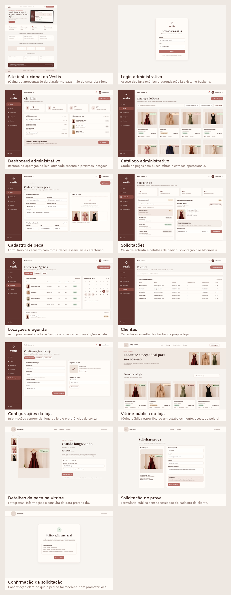
</div>

- **Aplicação Única:** Um único backend Spring Boot atende a todos os estabelecimentos com máxima eficiência de recursos e facilidade de implantação.
- **Banco de Dados Compartilhado com Isolamento Lógico:** Todas as tabelas de domínio armazenam a chave estrangeira `store_id`. Consultas e operações administrativas são isoladas pelo identificador da loja do funcionário logado.
- **Segurança Multi-Tenant Contínua:** Além da autenticação padrão com Spring Security, o componente customizado `AdminStoreActiveAuthorizationManager` intercepta todas as requisições em `/admin/**`, validando no banco de dados se a loja associada ao colaborador permanece ativa naquele exato instante.
- **Identificação Pública por Slug:** Rotas públicas identificam o estabelecimento pelo slug da URL (`/lojas/{slug}`), validando se a loja está habilitada para exibição.

### Organização dos Módulos (Pacotes Java)

```
com.clothingrental/
├── auth/            # [Implementado] Autenticação administrativa, contas de funcionários e segurança
├── tenant/          # [Implementado] Multi-tenancy, ciclo de vida de lojas e resolução de loja ativa
├── institutional/   # [Implementado] Site institucional da plataforma e páginas abertas
├── shared/          # [Implementado] Infraestrutura transversal, tratamento de exceções e design system
├── catalog/         # [Planejado] Cadastro de peças, fotos, categorias e estados físicos
├── customer/        # [Planejado] Cadastro de clientes e histórico de locações
├── rentalrequest/   # [Planejado] Recebimento e triagem de solicitações vindas das vitrines
└── reservation/     # [Planejado] Locações oficiais, agenda de datas e bloqueio de disponibilidade
```

---

## 🎨 Telas e Referências Visuais

O projeto conta com um Design System consistente e documentado em [`docs/design-system/README.md`](docs/design-system/README.md).

> **Aviso de Transparência:** As telas 01, 02 e 03 representam funcionalidades já implementadas e testadas. As telas de 04 a 13 representam protótipos visuais aprovados das funcionalidades planejadas para as próximas etapas do projeto.

### 🌐 1. Ambiente Institucional (Site Público)

| Tela | Status | Visualização |
|---|---|---|
| **Tela 01 — Site Institucional (`GET /`)**<br>Apresentação comercial do SaaS, diferenciais e vitrine de lojas parceiras. | ✅ Implementado | 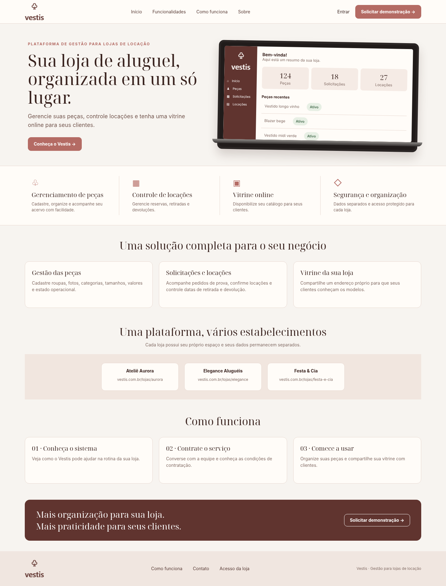 |

---

### 🔐 2. Ambiente Administrativo (`/admin`)

<details open>
<summary><strong>Clique para expandir as telas administrativas</strong></summary>
<br>

| Tela | Status | Visualização |
|---|---|---|
| **Tela 02 — Login Administrativo (`GET /login`)**<br>Acesso restrito de funcionários com CSRF e validação de loja ativa. | ✅ Implementado | 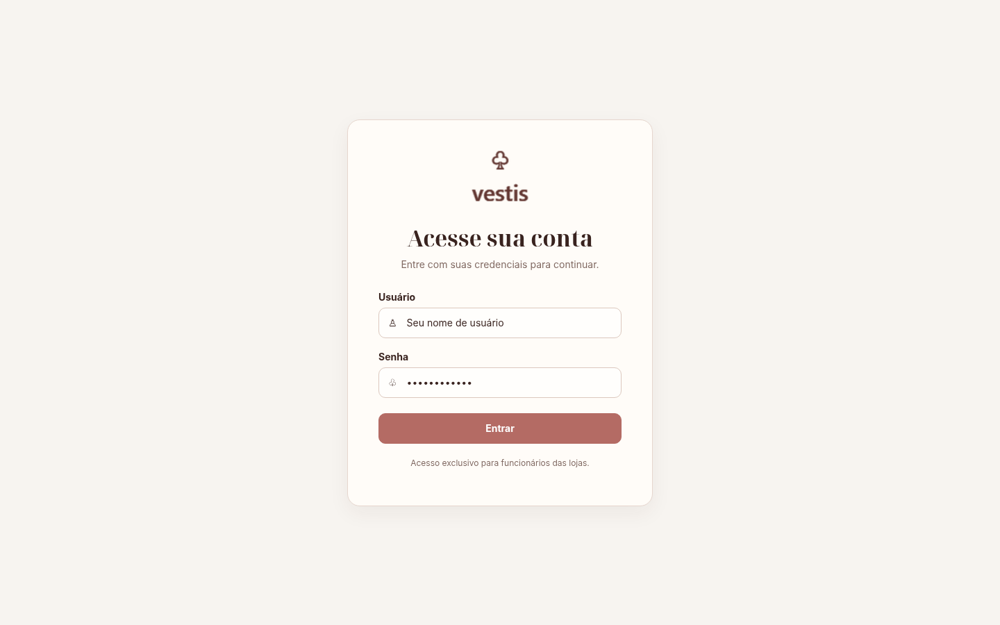 |
| **Tela 03 — Dashboard Principal (`GET /admin`)**<br>Visão geral da loja, métricas operacionais zeradas e atalhos rápidos. | ✅ Implementado | 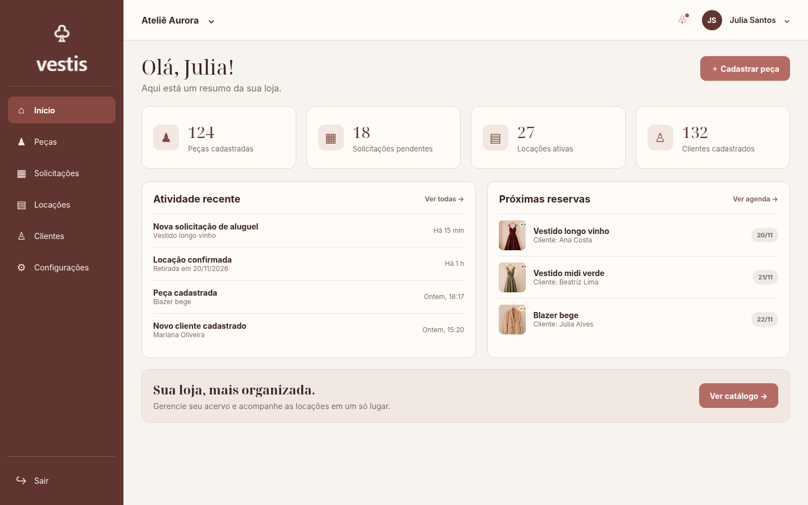 |
| **Tela 04 — Catálogo de Peças (`/admin/pecas`)**<br>Gestão do acervo de vestidos e ternos com filtros de estado e busca. | ⏳ *Protótipo / Planejado* | 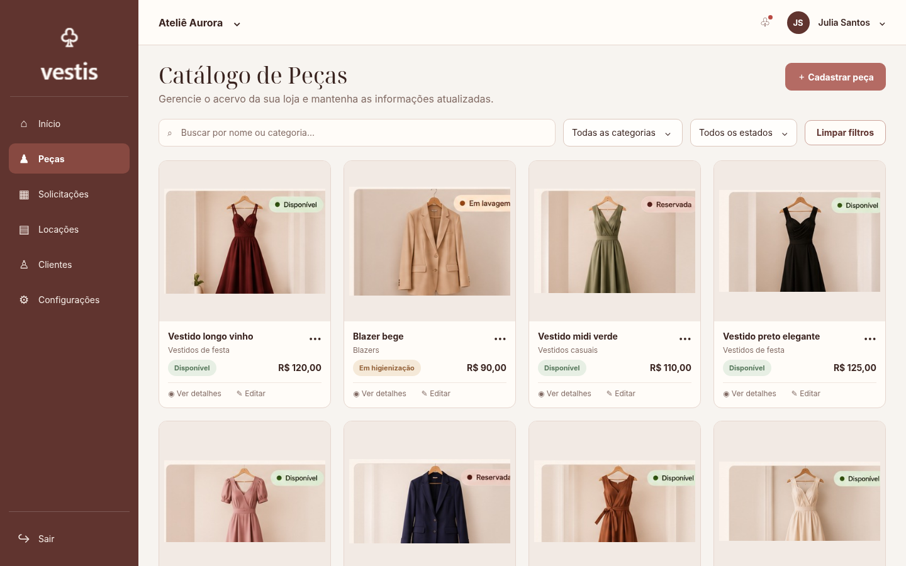 |
| **Tela 05 — Cadastro de Nova Peça (`/admin/pecas/novo`)**<br>Formulário de cadastro com proporção 4:5 de fotos e medidas. | ⏳ *Protótipo / Planejado* | 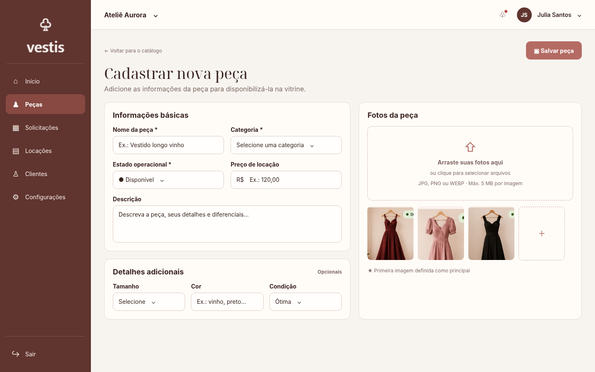 |
| **Tela 06 — Gestão de Solicitações (`/admin/solicitacoes`)**<br>Triagem de pedidos de prova recebidos pela vitrine online. | ⏳ *Protótipo / Planejado* | 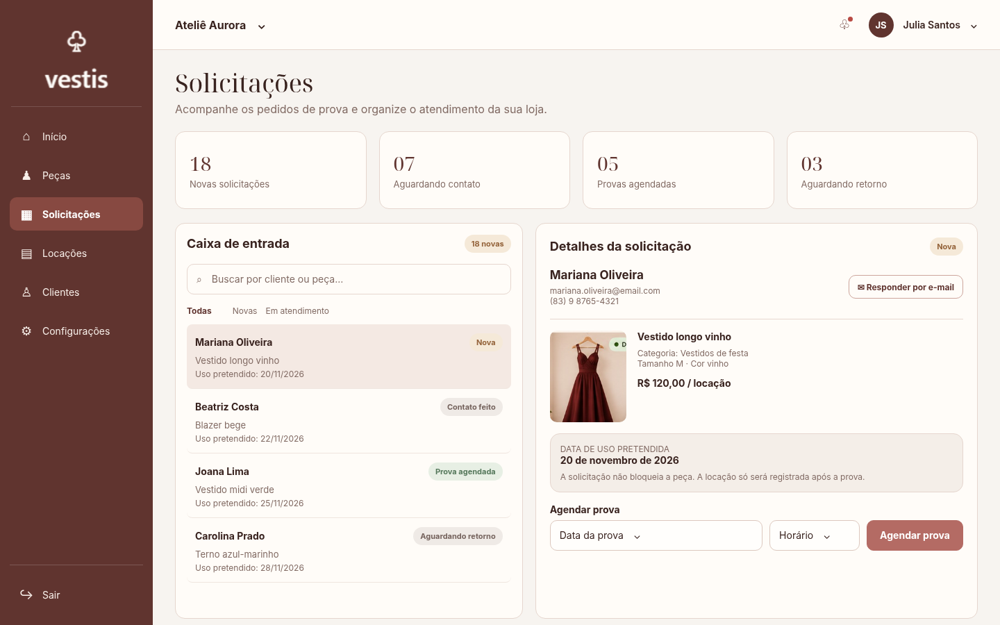 |
| **Tela 07 — Locações e Agenda (`/admin/locacoes`)**<br>Calendário de retiradas, devoluções e agendamentos de provas. | ⏳ *Protótipo / Planejado* | 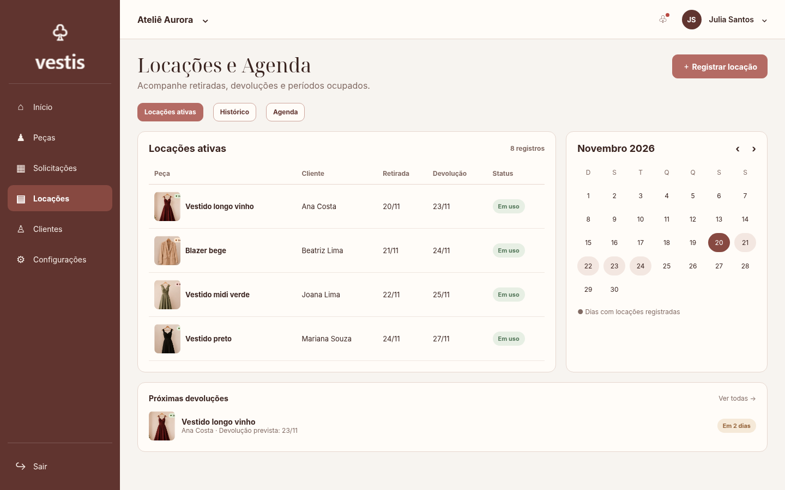 |
| **Tela 08 — Base de Clientes (`/admin/clientes`)**<br>Listagem de clientes com histórico de locações e dados de contato. | ⏳ *Protótipo / Planejado* | 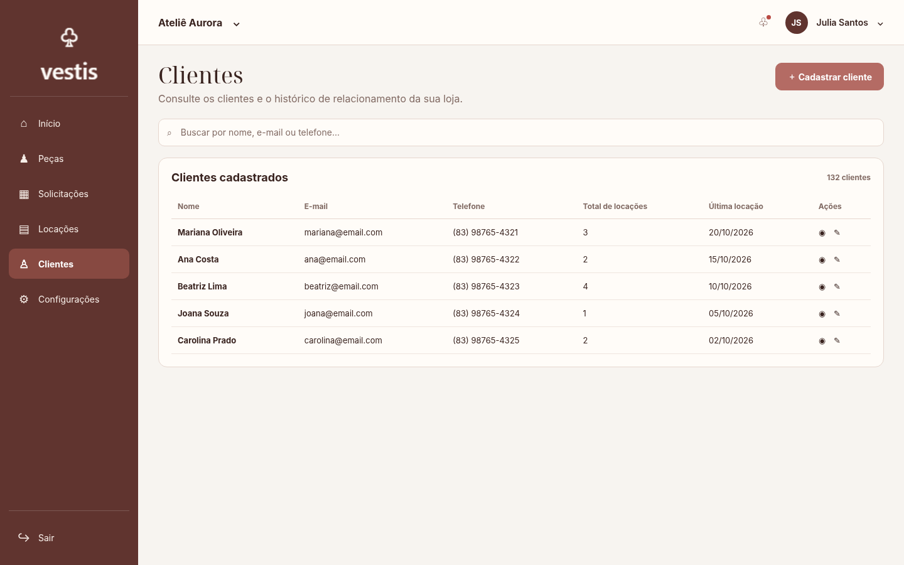 |
| **Tela 09 — Configurações da Loja (`/admin/configuracoes`)**<br>Edição de horários, dados do estabelecimento e dados da conta. | ⏳ *Protótipo / Planejado* | 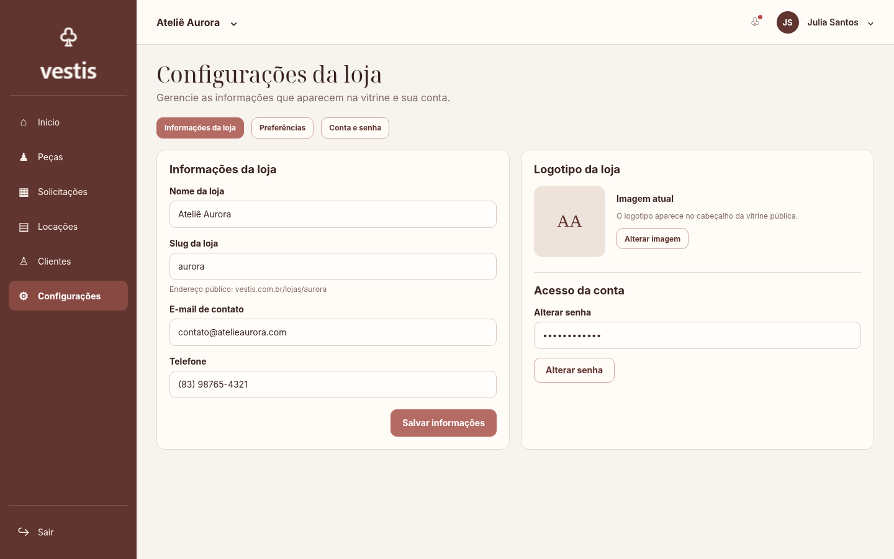 |

</details>

---

### 👗 3. Ambiente da Vitrine Pública (`/lojas/{slug}`)

<details>
<summary><strong>Clique para expandir as telas da vitrine pública</strong></summary>
<br>

| Tela | Status | Visualização |
|---|---|---|
| **Tela 10 — Vitrine Digital da Loja (`/lojas/{slug}`)**<br>Catálogo online aberto para consulta pública de peças e vestidos. | ⏳ *Protótipo / Planejado* | 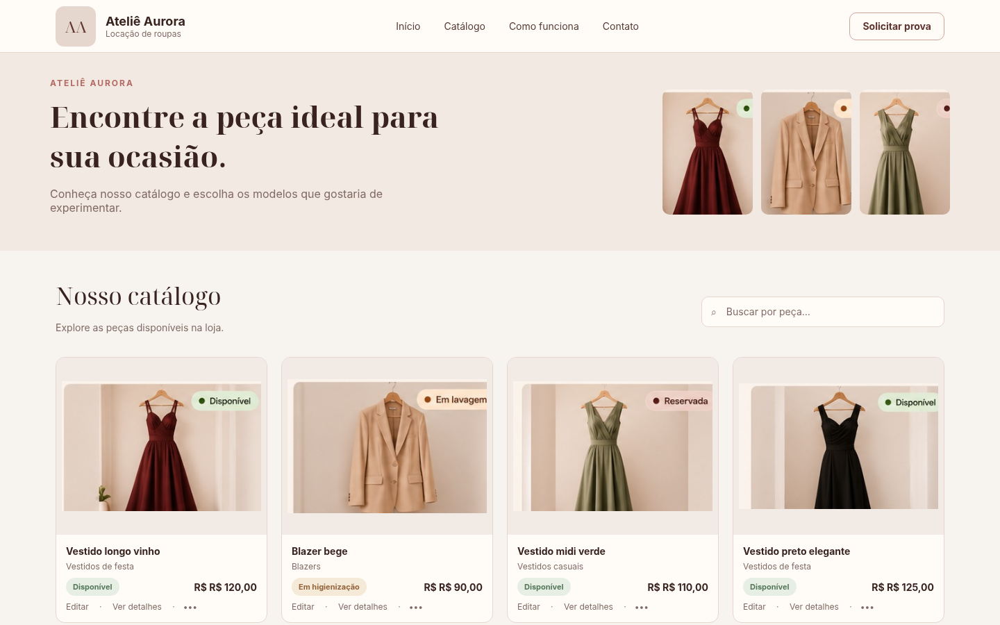 |
| **Tela 11 — Detalhes da Peça (`/lojas/{slug}/pecas/{id}`)**<br>Fotos em alta resolução, ficha técnica, tecidos e valor da locação. | ⏳ *Protótipo / Planejado* | 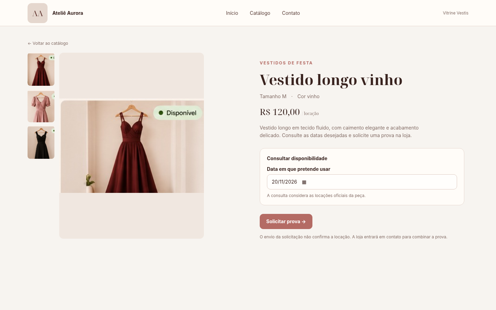 |
| **Tela 12 — Solicitação de Prova**<br>Formulário sem necessidade de login para agendar prova da peça. | ⏳ *Protótipo / Planejado* | 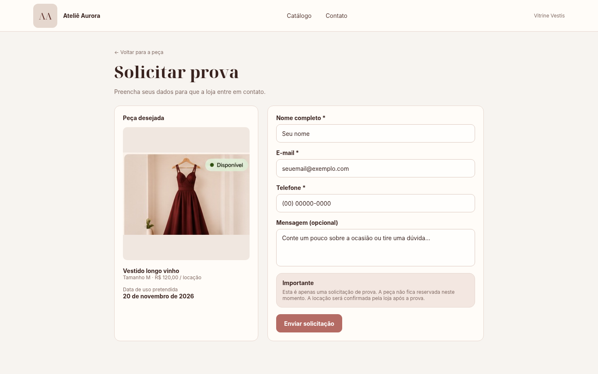 |
| **Tela 13 — Confirmação da Solicitação**<br>Mensagem de sucesso com protocolo e instruções de contato pela loja. | ⏳ *Protótipo / Planejado* | 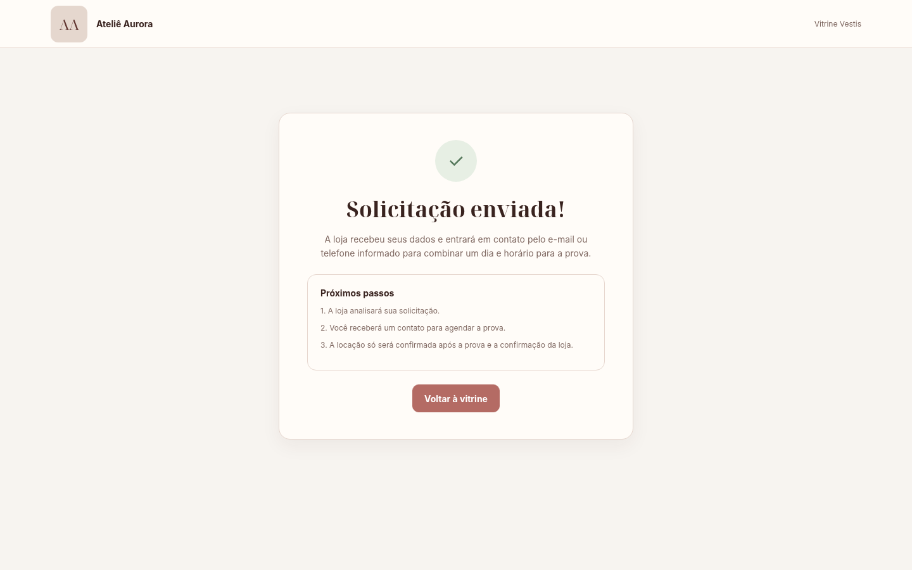 |

</details>

---

## 🛠 Tecnologias Utilizadas

- **Linguagem & Plataforma:** Java 21 (LTS).
- **Framework Principal:** Spring Boot 4.1.2.
- **Segurança & Controle de Sessões:** Spring Security 7.0 com BCrypt e `AuthorizationManager` dinâmico.
- **Camada Web & Renderização:** Spring MVC e Thymeleaf (renderização server-side moderna).
- **Persistência de Dados:** Spring Data JPA e Hibernate 7.
- **Banco de Dados Relacional:** PostgreSQL 17 (containerizado via Docker).
- **Versionamento de Banco de Dados:** Flyway (migrações SQL com Hibernate em modo `validate`).
- **Frontend & Interface:** HTML5 semântico, CSS3 (Design System modular com variáveis CSS), JavaScript nativo e Bootstrap 5.3.3 local.
- **Gerenciador de Dependências e Build:** Maven 3 com Maven Wrapper (`mvnw`).
- **Testes Automatizados:** JUnit 5 (Jupiter), Mockito e Spring Security Test (**98 testes aprovados**).

---

## 🚀 Como Executar Localmente

### Pré-requisitos
- **Java 21** instalado (ex.: Eclipse Temurin 21).
- **Docker Desktop** em execução.
- **Git** configurado.

### 1. Clonar o repositório
```powershell
git clone https://github.com/madu-santos/Projeto-vestis.git
cd Projeto-vestis
```

### 2. Configurar as variáveis de ambiente
Crie o arquivo `.env` a partir do modelo `.env.example`:
```powershell
Copy-Item .env.example .env
```

Edite o arquivo `.env` e configure as credenciais locais. Certifique-se de preencher as variáveis do primeiro administrador no perfil `dev`:
```env
DB_HOST=localhost
DB_PORT=5432
DB_NAME=clothing_rental
DB_USERNAME=clothing_rental
DB_PASSWORD=sua-senha-do-postgres
SERVER_PORT=8080

# Loja inicial criada automaticamente no primeiro início em dev
STORE_NAME=Ateliê Aurora
STORE_SLUG=atelie-aurora

# Administrador inicial (a senha DEVE ter no mínimo 12 caracteres)
ADMIN_USERNAME=admin
ADMIN_PASSWORD=senha-super-segura-123
```

> **Atenção:** O arquivo `.env` real contém credenciais privadas e **nunca é versionado** (protegido no `.gitignore`).

### 3. Iniciar o Banco de Dados (PostgreSQL)
```powershell
docker compose up -d
docker compose ps
```
Aguarde o status do container `clothing-rental-postgres` indicar `healthy`.

### 4. Executar a Aplicação com Maven Wrapper
No PowerShell do Windows:
```powershell
# Aponta a variável JAVA_HOME para o seu JDK 21 caso necessário
$env:JAVA_HOME = "$env:USERPROFILE\.jdks\temurin-21.0.13"  # ou o caminho da sua instalação do JDK 21

# Inicia a aplicação no perfil de desenvolvimento
.\mvnw.cmd spring-boot:run
```

### 5. Acessar as Rotas Locais
Assim que o console indicar `Started ClothingRentalApplication in ... seconds`:
- 🌐 **Site Institucional (Público):** [http://localhost:8080/](http://localhost:8080/)
- 🔑 **Login Administrativo:** [http://localhost:8080/login](http://localhost:8080/login) *(use o usuário e a senha definidos no `.env`)*
- 📊 **Dashboard Administrativo:** [http://localhost:8080/admin](http://localhost:8080/admin)

### 6. Executar a Suíte de Testes
```powershell
$env:JAVA_HOME = "$env:USERPROFILE\.jdks\temurin-21.0.13"
.\mvnw.cmd test
```
*Total: 98 testes automatizados executados e aprovados.*

---

## 📊 Estado Atual do Desenvolvimento

| Módulo / Funcionalidade | Situação | Detalhes |
|---|---|---|
| **Fundação Técnica & Configurações** | ✅ **Implementado** | Spring Boot 4.1.2, Java 21, Flyway, PostgreSQL 17 e Maven Wrapper. |
| **Arquitetura Multi-Tenant** | ✅ **Implementado** | Isolamento por `store_id`, resolução por slug e suporte a múltiplas lojas. |
| **Autenticação & Sessões Seguras** | ✅ **Implementado** | Spring Security 7, hash BCrypt, interceptor dinâmico para loja ativa. |
| **Site Institucional (Tela 01)** | ✅ **Implementado** | Posicionamento do produto, diferenciais, lojas piloto e apresentação. |
| **Login Administrativo (Tela 02)** | ✅ **Implementado** | Formulário de 44px, ícones embutidos, proteção CSRF e mensagens de erro. |
| **Dashboard Administrativo (Tela 03)** | ✅ **Implementado** | Sidebar de 220px, header de 72px, stat cards e empty states. |
| **Design System & Componentes** | ✅ **Implementado** | Paleta terracota/marrom nobre, tipografia oficial e estilos consolidados. |
| **Catálogo de Peças (Telas 04 e 05)** | ⏳ *Planejado* | Cadastro de vestidos, gestão de fotos 4:5 e tamanhos. |
| **Solicitações de Locação (Telas 06 e 07)** | ⏳ *Planejado* | Triagem de pedidos e fluxo de aprovação pela loja. |
| **Locações & Agenda (Tela 08)** | ⏳ *Planejado* | Calendário de locações e bloqueio de datas. |
| **Gestão de Clientes (Tela 09)** | ⏳ *Planejado* | Listagem de clientes e histórico de locações. |
| **Configurações da Loja (Tela 10)** | ⏳ *Planejado* | Parâmetros de funcionamento e edição de dados do tenant. |
| **Vitrine Pública da Loja (Telas 11 a 13)** | ⏳ *Planejado* | Catálogo aberto por slug e solicitação de prova pelo cliente. |

---

## 🎯 Objetivo Acadêmico e Profissional

O **Vestis** foi projetado para demonstrar na prática padrões arquiteturais sólidos e boas práticas de engenharia de software no ecossistema Java corporativo:
- **Separação de responsabilidades** e desacoplamento através de monólito modular;
- **Isolamento de dados multi-tenant** em ambiente compartilhado seguro;
- **Segurança em profundidade** contra desativação concorrente de tenants durante sessões ativas;
- **Design System profissional e acessível**, com layouts responsivos e foco na usabilidade do operador e do cliente final.

---

<div align="center">
  <p>Desenvolvido com dedicação por <strong>Maria Eduarda Santos</strong></p>
  <p><a href="https://github.com/madu-santos">github.com/madu-santos</a></p>
</div>
