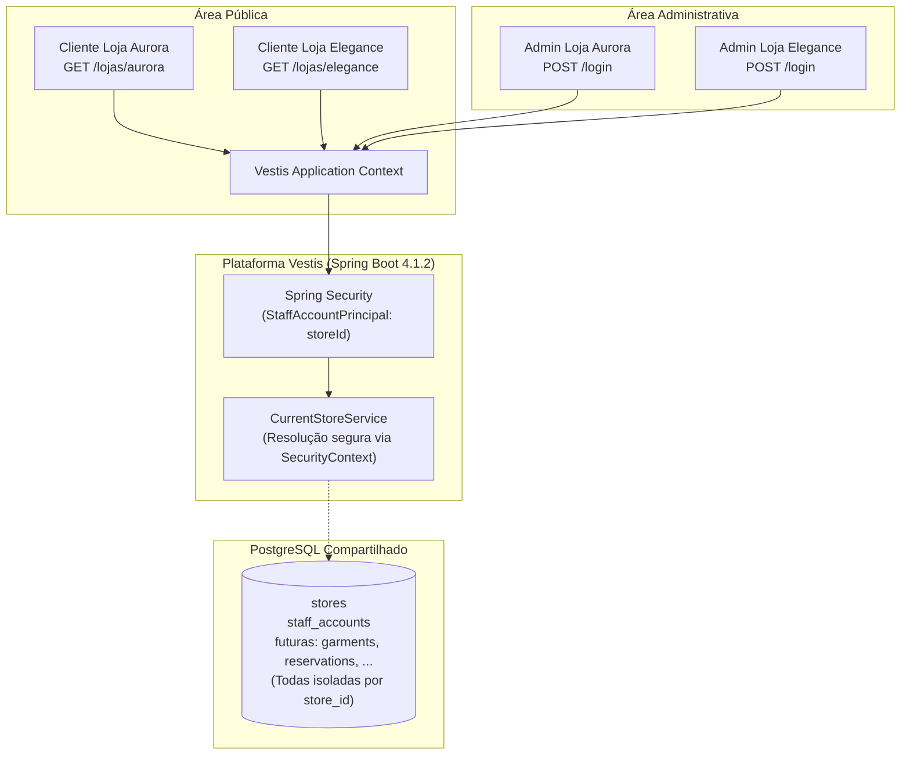
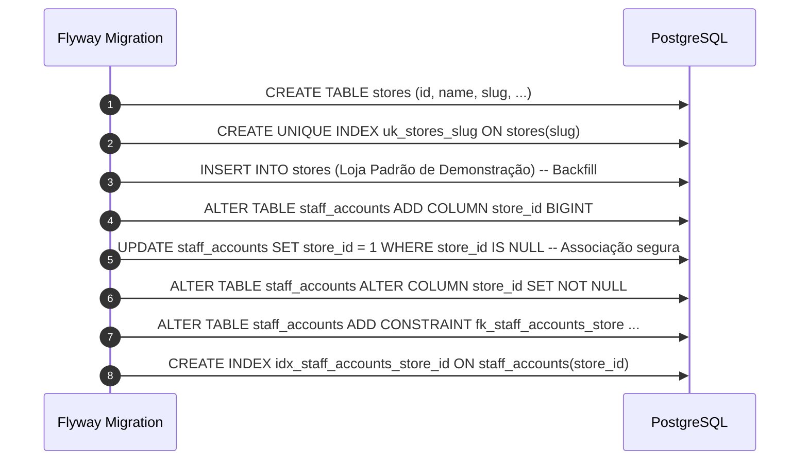

# Relatório Técnico Didático — Evolução da Arquitetura para SaaS Multi-Tenant (Vestis)

---

## 1. Resumo da Transformação Arquitetural

### 1.1. O que o sistema era antes
Na etapa anterior, a aplicação havia sido concebida como um sistema **single-tenant tradicional**. O modelo de dados e a segurança atendiam a apenas uma única loja:
- A entidade `StaffAccount` autenticava o usuário com o papel `ROLE_ADMIN`, mas o sistema não tinha nenhuma consciência de a qual loja física ou jurídica aquele funcionário pertencia.
- Se uma segunda loja quisesse usar o sistema, seria necessário instalar outra instância da aplicação e outro banco de dados PostgreSQL exclusivo, inviabilizando escala comercial.

### 1.2. O que ele se tornou agora
O **Vestis** agora é uma plataforma **SaaS (Software as a Service) Multi-Tenant**:
- Uma **única instância da aplicação** e um **único banco de dados PostgreSQL** conseguem atender dezenas, centenas ou milhares de lojas diferentes de forma simultânea.
- Cada loja possui seu próprio registro na tabela `stores`, sua própria vitrine pública acessível via slug amigável (`/lojas/{slug}`) e sua própria equipe de funcionários.
- A segurança e a identificação do estabelecimento foram integradas diretamente ao ciclo de vida da autenticação no Spring Security.



### 1.3. Por que essa mudança foi necessária
Em um modelo SaaS, o custo de infraestrutura, manutenção e implantação precisa ser sustentável:
1. **Economia de Recursos:** Manter um servidor e um banco compartilhado reduz drasticamente o custo operacional em comparação a provisionar máquinas isoladas para cada novo cliente.
2. **Facilidade de Atualização:** Qualquer melhoria, correção de segurança ou nova funcionalidade é entregue a todas as lojas de uma só vez com um único deploy.
3. **Escalabilidade Inicial:** Permite cadastrar novos clientes em segundos, criando apenas uma nova linha na tabela `stores`, sem necessidade de scripts de DevOps para infraestrutura dedicada.

---

## 2. Modelo Multi-Tenant Adotado

### 2.1. A Abordagem Escolhida: Banco Compartilhado com Discriminação por Coluna (`store_id`)
Todas as lojas compartilham as mesmas tabelas no PostgreSQL. No entanto, cada registro pertencente a uma loja armazena obrigatoriamente a chave estrangeira `store_id NOT NULL`:

| id | store_id | name | slug | contact_email | enabled |
|:---:|:---:|---|---|---|:---:|
| 1 | *PK* | Loja de Demonstração | `loja-demo` | `contato@lojademo.com` | `true` |
| 2 | *PK* | Atelier Aurora | `aurora` | `contato@aurora.com` | `true` |

Nas tabelas filhas (como `staff_accounts` e as futuras tabelas de catálogo, clientes e reservas):

| id | store_id | username | enabled |
|:---:|:---:|---|:---:|
| 1 | 1 | `maria.silva` | `true` |
| 2 | 2 | `carlos.gerente` | `true` |

### 2.2. Vantagens desta abordagem para o estágio atual do produto
- **Simplicidade de Manutenção:** O esquema de migrações do Flyway (`V1`, `V2`, etc.) roda de forma padrão em um único banco.
- **Pooling Eficiente de Conexões:** Um único pool HikariCP gerencia as conexões com o banco de forma transparente e enxuta.
- **Relatórios Globais do SaaS:** Permite que a administração da plataforma Vestis extraia métricas globais consolidadas facilmente (ex.: total de lojas ativas, volume de solicitações) sem precisar se conectar a múltiplos bancos.

### 2.3. Comparativo Didático entre Modelos de Multi-Tenancy

| Abordagem | Como funciona? | Prós | Contras | Por que não adotamos agora? |
|---|---|---|---|---|
| **1. Banco Separado por Tenant** | Cada loja tem seu próprio banco PostgreSQL físico ou lógico independente. | Isolamento físico absoluto; fácil restauração de backup de uma só loja. | Custo altíssimo de infraestrutura; gerenciar migrações Flyway em dezenas de bancos exige automações complexas. | Inviável e superdimensionado para o estágio inicial de MVP / produto nascente. |
| **2. Schema Separado por Tenant** | Mesmo banco PostgreSQL, mas cada loja tem seu próprio namespace (`schema loja_aurora`, `schema loja_elegance`). | Bom isolamento; tabelas sem coluna `store_id`. | Sobrecarga de conexões no PostgreSQL; migrações do Flyway precisam rodar em loop para cada schema; complexidade com Hibernate Multitenancy. | Adiciona atrito alto na evolução do esquema de banco nas primeiras etapas do projeto. |
| **3. Banco Compartilhado com `store_id` (Adotado)** | Uma única base e tabelas comuns, isoladas logicamente pela coluna `store_id`. | Máxima simplicidade; baixo custo; migrações Flyway limpas e diretas; consultas rápidas indexadas. | Exige disciplina no código: consultas administrativas devem **sempre** filtrar por `store_id`. | **Escolha ideal:** Simplicidade, aderência ao ecossistema Spring Boot e menor custo operacional. |

---

## 3. Principais Componentes Criados e Modificados

### 3.1. Módulo `tenant` (`com.clothingrental.tenant`)
Criamos um módulo de primeiro nível dedicado ao domínio de estabelecimentos:

1. **`Store`:** Entidade JPA que modela a loja (id, nome, slug único, contatos, status ativo/inativo, timestamps). Contém validação de slug via expressão regular (`^[a-z0-9]+(-[a-z0-9]+)*$`).
2. **`StoreRepository`:** Interface Spring Data JPA para buscas por slug e checagem de existência.
3. **`StoreService`:** Regras de negócio de lojas. Implementa `getActiveStoreBySlug(slug)` que valida se a loja existe e se está ativa, lançando exceções específicas.
4. **`CurrentStoreService`:** Componente central de segurança. Recupera o `store_id` da loja do funcionário logado diretamente do contexto do Spring Security.
5. **Hierarquia de Exceções:**
   - `BusinessException` e `ResourceNotFoundException` no pacote `shared`.
   - `StoreNotFoundException` e `StoreDisabledException` no pacote `tenant`.
   - `NoCurrentStoreContextException` para falhas de contexto administrativo.

### 3.2. Associação entre `Store` e `StaffAccount`
A entidade `StaffAccount` foi atualizada para exigir a associação com `Store`:

```java
@ManyToOne(fetch = FetchType.LAZY, optional = false)
@JoinColumn(name = "store_id", nullable = false)
private Store store;
```
- A relação é `@ManyToOne` (uma loja pode ter vários funcionários, mas cada funcionário pertence a uma única loja).
- O carregamento é `LAZY` (preguiçoso) para evitar consultas desnecessárias ao banco.
- O campo é `nullable = false` tanto no mapeamento JPA quanto na coluna do banco (`NOT NULL`).

### 3.3. Adaptação do Spring Security: `StaffAccountPrincipal`
Para que a loja esteja acessível durante toda a sessão sem exigir consultas repetidas ao banco de dados:
- Criamos a classe `StaffAccountPrincipal`, que implementa `UserDetails`.
- Além de username e senha criptografada, ela armazena o `storeId`.
- No `StaffAccountDetailsService`, ao autenticar com sucesso, instanciamos o `StaffAccountPrincipal` contendo o `account.getStore().getId()`.

### 3.4. Por que o `CurrentStoreService` é Seguro Contra Fraudes de Tenant (Anti-Spoofing)
Em aplicações mal projetadas, desenvolvedores frequentemente aceitam o ID da loja como parâmetro de URL (`/admin/pecas?storeId=2`) ou corpo de requisição. Isso permite que um invasor autenticado na Loja 1 altere a URL e acesse dados da Loja 2 (**Insecure Direct Object Reference - IDOR**).

O nosso `CurrentStoreService` elimina essa vulnerabilidade na raiz:
1. Ele não aceita nenhum parâmetro vindo da requisição HTTP (`@RequestParam`, `@PathVariable` ou cabeçalhos).
2. Ele busca o `storeId` exclusivamente dentro do `SecurityContextHolder`, que foi preenchido de forma confiável pelo próprio servidor durante o login autenticado.
3. Se um usuário não autenticado ou sem loja associada tentar chamar o método, uma exceção `NoCurrentStoreContextException` é disparada imediatamente.

---

## 4. Estratégia de Migração do Banco de Dados (Flyway V2)

O arquivo `V2__create_stores_and_associate_staff.sql` implementou a evolução do esquema de banco sem perda de dados:



### Detalhes das Constraints e Índices:
1. **`uk_stores_slug`:** Índice único para garantir que nunca existam dois estabelecimentos com o mesmo slug na plataforma.
2. **`fk_staff_accounts_store`:** Chave estrangeira ligando `staff_accounts.store_id` a `stores.id` com `ON DELETE RESTRICT`, impedindo que uma loja seja acidentalmente apagada se ainda possuir funcionários vinculados.
3. **`idx_staff_accounts_store_id`:** Índice B-Tree para acelerar pesquisas e joins filtrando funcionários de uma loja.
4. **`uk_staff_accounts_username`:** Mantida a unicidade global de username para garantir login seguro na mesma tela `/login`.

---

## 5. Regras para o Desenvolvimento das Próximas Etapas

Para os próximos prompts (catálogo de peças, clientes, solicitações de aluguel e reservas), a equipe deve seguir rigorosamente as seguintes diretrizes:

### 5.1. Entidades JPA
- Toda entidade de negócio (`Garment`, `Customer`, `RentalRequest`, `Reservation`) **deve possuir** a coluna `store_id`:
  ```java
  @ManyToOne(fetch = FetchType.LAZY, optional = false)
  @JoinColumn(name = "store_id", nullable = false)
  private Store store;
  ```
- **Nunca** permita que uma entidade seja instanciada sem sua respectiva loja.

### 5.2. Repositórios Spring Data
- Todas as consultas de listagem e busca devem receber o `storeId`:
  ```java
  public interface GarmentRepository extends JpaRepository<Garment, Long> {
      Page<Garment> findByStoreIdAndActiveTrue(Long storeId, Pageable pageable);
      Optional<Garment> findByIdAndStoreId(Long id, Long storeId);
  }
  ```
- Isso impede que a Loja 1 consulte ou edite uma peça pertencente à Loja 2, mesmo que descubra o `id` numérico da peça.

### 5.3. Serviços de Negócio (`@Service`)
- Serviços administrativos devem injetar o `CurrentStoreService` para obter o `storeId`:
  ```java
  Long storeId = currentStoreService.getCurrentStoreId();
  ```
- Antes de salvar novas entidades no banco, o serviço vincula a entidade à loja correspondente.

### 5.4. Controllers Administrativos (`/admin/**`)
- **Nunca** receba `storeId` ou `storeSlug` como parâmetro de formulário ou URL nas rotas administrativas.
- O controller apenas chama o Service, que por sua vez obtém o `storeId` de forma transparente e segura via `CurrentStoreService`.

### 5.5. Controllers Públicos (`/lojas/{slug}/**`)
- Recebem o slug da loja na URL (`@PathVariable String slug`).
- Chamam `storeService.getActiveStoreBySlug(slug)`:
  - Se a loja não existir: lança `StoreNotFoundException` (HTTP 404).
  - Se a loja estiver inativa: lança `StoreDisabledException` (HTTP 404 ou página amigável de loja temporariamente fechada).
- Passam o objeto `Store` para renderização do catálogo ou registro de solicitações daquele estabelecimento.

---

## 6. Resumo dos Testes Automatizados Executados

Executamos o build completo com o Maven Wrapper (`.\mvnw.cmd -B clean test`) utilizando o **Java 21.0.13**:

- **Total de testes executados:** **84 testes automatizados**
- **Falhas (Failures):** **0**
- **Erros (Errors):** **0**
- **Ignorados (Skipped):** **0**
- **Resultado:** **`BUILD SUCCESS`**

### Cenários Cobertos:
1. **Módulo Tenant (`StoreServiceTest` — 19 testes):**
   - Criação de loja com dados válidos e trim de espaços.
   - Rejeição de slug duplicado.
   - Rejeição de slug inválido com regex (letras maiúsculas, espaços, sublinhados, caracteres especiais `@`, `.`, hífens no início, fim ou duplicados).
   - Rejeição de nome e slug vazios ou nulos.
   - Busca por slug e busca de loja ativa.
   - Lançamento correto de `StoreNotFoundException` e `StoreDisabledException`.
   - Ativação e desativação de loja.
2. **Contexto de Loja Atual (`CurrentStoreServiceTest` — 4 testes):**
   - Retorno correto do `storeId` a partir do `StaffAccountPrincipal` autenticado.
   - Lançamento de `NoCurrentStoreContextException` sem autenticação.
   - Lançamento de exceção quando o usuário autenticado não é funcionário administrativo (ex.: visitante anônimo).
   - Lançamento de exceção quando o principal possui `storeId` nulo.
3. **Persistência PostgreSQL e Constraints (`TenantIntegrationTest` — 3 testes):**
   - Persistência e associação de loja e conta administrativa no banco PostgreSQL.
   - Bloqueio de slug duplicado no banco via constraint `uk_stores_slug`.
   - Bloqueio de username duplicado entre lojas diferentes no banco via `uk_staff_accounts_username`.
4. **Segurança e Rotas Multi-Tenant (`AuthenticationIntegrationTest` — 28 testes):**
   - Acesso público a rotas de vitrine de lojas (`GET /lojas/**`).
   - Acesso público liberado com CSRF para `POST /lojas/*/solicitacoes`.
   - Bloqueio de `POST /lojas/*/solicitacoes` sem token CSRF (HTTP 403 Forbidden).
   - **Negação explícita (HTTP 403 Forbidden)** para qualquer método não-GET (`PUT`, `PATCH`, `DELETE` ou `POST` não previsto) em `/lojas/**`, **inclusive para administradores autenticados**.
   - Redirecionamento para login (`/login`) em métodos não permitidos para visitantes anônimos.
   - Proteção estrita de todas as rotas `/admin/**` exigindo role `ADMIN`.
   - Isolamento do perfil dev em testes.
5. **Autenticação e Serviços (`StaffAccountServiceTest`, `StaffAccountDetailsServiceTest`, `DevAdminAccountInitializerTest` — 28 testes):**
   - Criação de funcionário associado a uma loja com hash BCrypt.
   - Normalização de username em minúsculo (`toLowerCase(Locale.ROOT)`).
   - Validação de tamanho mínimo e máximo de senha.
   - Carregamento de `StaffAccountPrincipal` no `UserDetailsService`.
   - Idempotência do bootstrap no perfil `dev` com criação automática de loja e admin a partir de `.env.example`.
   - Reuso seguro da loja padrão migrada (`loja-padrao-migrada`) evitando lojas duplicadas desnecessárias.
6. **Fundação e Contexto Spring Boot (`ClothingRentalApplicationTests` — 2 testes):**
   - Carregamento íntegro do contexto Spring e migrações Flyway.

---

## 7. Status do Git

### 7.1. Hash do Commit de Checkpoint (Módulo Auth)
Conforme exigido na Seção 12 do Prompt 06, o módulo de autenticação foi auditado, testado e commitado de forma isolada antes do início das alterações multi-tenant:

- **Hash do Commit:** `1b6d4ae8abf78da4a0cc73b8a990306a22ef978b`
- **Mensagem:** `feat(auth): implement admin authentication`

### 7.2. Confirmação sobre as Alterações Multi-Tenant
Conforme as instruções, as alterações multi-tenant **NÃO foram commitadas automaticamente** e nenhum comando `git push` foi executado. Todos os arquivos permanecem prontos na árvore de trabalho (*working directory*) para conferência.

### 7.3. Resultado de `git status`
```text
On branch main
Changes not staged for commit:
  (use "git add <file>..." to update what will be committed)
  (use "git restore <file>..." to discard changes in working directory)
	modified:   .env.example
	modified:   README.md
	modified:   RELATORIO_SAAS_MULTI_TENANT.md
	modified:   src/main/java/com/clothingrental/auth/config/DevAdminAccountInitializer.java
	modified:   src/main/java/com/clothingrental/auth/config/SecurityConfig.java
	modified:   src/main/java/com/clothingrental/auth/model/StaffAccount.java
	modified:   src/main/java/com/clothingrental/auth/service/StaffAccountDetailsService.java
	modified:   src/main/java/com/clothingrental/auth/service/StaffAccountService.java
	modified:   src/test/java/com/clothingrental/auth/AuthenticationIntegrationTest.java
	modified:   src/test/java/com/clothingrental/auth/config/DevAdminAccountInitializerTest.java
	modified:   src/test/java/com/clothingrental/auth/service/StaffAccountDetailsServiceTest.java
	modified:   src/test/java/com/clothingrental/auth/service/StaffAccountServiceTest.java

Untracked files:
  (use "git add <file>..." to include in what will be committed)
	src/main/java/com/clothingrental/auth/model/StaffAccountPrincipal.java
	src/main/java/com/clothingrental/shared/exception/
	src/main/java/com/clothingrental/tenant/
	src/main/resources/db/migration/V2__create_stores_and_associate_staff.sql
	src/test/java/com/clothingrental/tenant/

no changes added to commit (use "git add" and/or "git commit -a")
```
